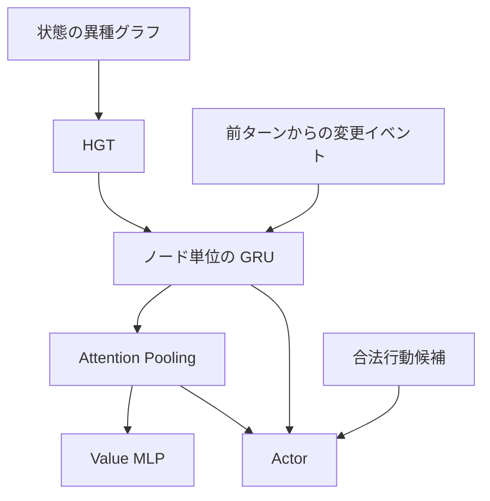

# HGT Maze

ターン制の迷路を使って、Heterogeneous Graph Transformer（HGT）がアイテム・扉・敵の関係を推論し、攻略行動に反映できるかを調べる実験環境です。迷路ごとにアイテムの効果や扉の開放条件が変わります。アイテム名はエピソードごとに割り当てる三文字の英小文字です。

生成、参照探索、事前学習、PPO・GRPO、評価、再生を同じ Python パッケージで実行できます。参照ソルバーと方策の実行は同じゲーム状態遷移を使います。

## クイックスタート

Python 3.11 以上が必要です。リポジトリのルートで実行します。

```bash
python -m venv .venv
source .venv/bin/activate
python -m pip install -e .

python -m maze_hgt --config config/smoke.toml check --seed 42 --render ascii --out outputs/demo
```

Windows PowerShell では、仮想環境の有効化に `.\.venv\Scripts\Activate.ps1` を使います。CUDA 対応版を使う場合は、環境に合う PyTorch を先に入れ、設定の `runtime.device` を `"auto"` または `"cuda"` にします。[PyTorch のインストール案内](https://pytorch.org/get-started/locally/)

`check` は盤面を生成し、参照ソルバーで攻略して、ログを再生検証します。端末に日本語のルール、ASCII 盤面、HP、所持品、扉や敵の座標を表示します。次のコマンドで、保存したログから各ターンの関係グラフと盤面を PNG にできます。

```bash
python -m maze_hgt replay outputs/demo/trace.json --render frames --out outputs/replayed
python -m unittest discover -s tests -v
```

## 盤面とモデル

ゴールへの到達、プレイヤーの死亡、ターン上限のいずれかで終了します。迷路の寸法、部屋や敵などの個数、依存関係の深さ、敵や効果の強さ、盤面ごとの関係密度にはパレート分布を使います。既定の形状パラメータは `1.9` で、個数と寸法は整数化して設定の範囲に収めます。配置先や効果の種類は候補集合から抽選します。扉は鍵、材質への破壊効果、複数アイテム、敵の死亡を AND・OR の条件として組み合わせられます。

ゲーム状態は、プレイヤー、敵、アイテム、扉、材質、効果、条件、状態異常、タイルなどの型付きグラフに変換します。敵ノードには現在HP、最大HP、基礎攻撃力が入り、弱点・耐性や敵同士の強化・保護・回復は向きを持つ関係で表します。アイテム名は表示用です。例えばアイテムの破壊効果と扉が同じ材質ノードを参照し、扉の条件がその効果を要求することで、アイテムと扉の対応を表現します。



GRU のメモリはノードIDに対応し、エピソード開始時にリセットします。消滅したノードは集約から外れ、消滅イベントは関連する生存ノードに届きます。Actor は候補ごとに対象、使用アイテム、行動種別、盤面埋め込みを使って採点します。合法候補は位置や所持品から決まり、アイテム使用の成否はゲームルールで判定します。

### 盤面の固定と参照探索

```bash
python -m maze_hgt --config config/smoke.toml generate --seed 42 --count 1 --out outputs/worlds
python -m maze_hgt --config config/smoke.toml solve --world outputs/worlds/world-42.json --mode exact --ties --out outputs/solution
```

通常の生成は参照解が見つかった盤面を採用します。小盤面には A*、大盤面には重み付き探索を使います。`optimal` は最短性を証明した解、`feasible` は実行可能な解、`impossible` は攻略不能の証明、`unknown` は探索予算内での判定保留です。

## 学習

| 段階 | 教師信号 |
| --- | --- |
| Stage 1 | 扉とアイテム、弱点、敵同士の関係、AND・OR などの関係推論。実ゲームのグラフと合成回路を使う |
| Stage 2 | 行動後の属性差分、ノードの生成・消滅、エッジの追加・削除 |
| Stage 3 | 到達可能な部屋、開けられる扉、倒せる敵、攻略可否などの盤面情報 |
| Stage 4 | 参照探索に基づく割引累積報酬。最短性と報酬設定に応じて厳密ラベルと近似ラベルを扱う |
| Stage 5 | 参照ソルバーの行動集合。複数の同等な最短行動を正解に含める |

次は CPU で一連の処理を確認する手順です。

```bash
python -m maze_hgt --config config/smoke.toml pretrain --stage all --out outputs/pretrain

python -m maze_hgt --config config/smoke.toml ppo \
  --init outputs/pretrain/stage5/best.pt --allow-unready --out outputs/ppo

python -m maze_hgt --config config/smoke.toml play \
  --model outputs/ppo/best.pt --seed 42 --render ascii --out outputs/play
```

`--allow-unready` は検証目標の未達を許容する短時間実験用の指定です。通常の PPO は、全段階の検証目標を満たした Stage 5 の重みから開始します。各段階の `metrics.jsonl` に指標の内訳、`status.json` に完了判定を記録します。

PPO は GAE とクリッピングを用い、GRU の履歴を再計算して系列単位で更新します。`grpo` では同じ初期盤面から得た複数の軌跡をグループとし、割引報酬から相対的な Advantage を作ります。

`best.pt` は検証で選ばれた重み、`last.pt` は最新の重みです。段階を分けて学習するときは `pretrain --stage N --init` に前段階の最良重みを指定します。中断した段階や PPO・GRPO の再開には、元の出力先と `--resume` に対応する `last.pt` を指定します。

| 設定 | 用途 |
| --- | --- |
| `config/smoke.toml` | 7×7 または 7×9 盤面での動作確認 |
| `config/experiment.toml` | 7〜15 の寸法範囲を使う学習と評価 |
| `config/relation.toml` | 5層 HGT での関係推論実験 |
| `config/pretrain200x.toml` | Stage 1 の生成盤面6,000件、Stage 2〜5 の訓練盤面1,200件、PPO 上限500更新の設定 |

## 評価

同じ未見盤面で、複数の重み、参照ソルバー、ランダム方策を比較できます。訓練・検証・テストは、シード、アイテム名の集合、壁と床の配置を分けます。`id` は基本設定の盤面、`ood` は大型・高依存で複合条件を持つ盤面です。

```bash
python -m maze_hgt --config config/smoke.toml evaluate --episodes 20 \
  --checkpoint pretrained=outputs/pretrain/stage5/best.pt \
  --checkpoint ppo=outputs/ppo/best.pt \
  --out outputs/evaluation.json

python -m maze_hgt plot --run outputs/ppo --out outputs/ppo-learning.png
```

`evaluate` と既定の `play` は最大確率の行動を選びます。`play --sample` は方策から行動を抽選します。評価 JSON には盤面別の成否とターン数、名前変更への感度、ルールだけを変更する反事実テスト、関係推論の指標が入ります。反事実テストは、扉が開くか、敵へのダメージが最大かといった一手の結果で行動を判定します。GRU やイベント入力、事前学習の有無は `ablate` で比較できます。

### 評価例

学習済み PPO チェックポイント `PPO2` を、通常20盤面と分布外20盤面で評価しました。各区分で、参照ソルバーとランダム方策にも同じ盤面を使いました。

| 方策 | 通常盤面 | 大型・複合盤面 |
| --- | ---: | ---: |
| 参照ソルバー | 20/20 | 20/20 |
| ランダム | 0/20 | 0/20 |
| PPO2 | 16/20（80%） | 8/20（40%） |

上の `smoke.toml` を使う手順は、学習と評価の流れを確認するためのものです。

### 評価上の注意点

- 対称な配置では、現行 Actor が効果の異なる行動候補に同じスコアを付ける場合があります。反事実テストはこの種の失敗を調べるために使います。
- Stage 5 の模倣学習は参照軌跡上の状態を対象とします。実走のクリア率は、行動を選び続けた結果も含めて測ります。
- 合成回路の一部の試験では、追加した要素が予測対象と別の連結成分にあります。関係の影響は、ルールを差し替えた実盤面での反事実テストと併せて評価します。

## リポジトリ構成

| パス | 内容 |
| --- | --- |
| `maze_hgt/game.py`、`generate.py`、`solver.py` | ゲームルール、迷路生成、参照探索 |
| `maze_hgt/graph.py`、`model.py` | 型付きグラフ、イベント、HGT、GRU、Actor・Critic |
| `maze_hgt/data.py`、`tasks.py`、`train.py` | 教師データと段階的な事前学習 |
| `maze_hgt/rl.py`、`evaluate.py` | PPO・GRPO、分布外・反事実評価 |
| `maze_hgt/play.py`、`render.py`、`cli.py` | 実行・再生、盤面表示、CLI |
| `config/`、`tests/` | 実験設定と自動テスト |

参考文献

- Hu et al., *Heterogeneous Graph Transformer*. [arXiv](https://arxiv.org/abs/2003.01332)
- Schulman et al., *Proximal Policy Optimization Algorithms*. [arXiv](https://arxiv.org/abs/1707.06347)
